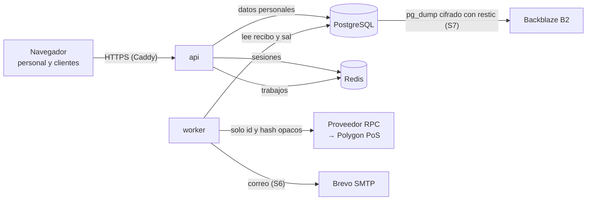

# Insumos técnicos para la evaluación de impacto (EIPD)

Datos, flujos y controles del SRPP para que Oasis Seguros elabore la evaluación de impacto del
tratamiento que exige la LOPDP. La valoración de riesgos y su conclusión las hace Oasis. Las
actividades y finalidades están en el [registro de actividades](registro-actividades-tratamiento.md).

## 1. Inventario de datos

Fuente: `apps/api/prisma/schema.prisma` y ARQUITECTURA §9.

| Dónde                             | Entidad o llave            | Datos personales                                                                                                              |
| --------------------------------- | -------------------------- | ----------------------------------------------------------------------------------------------------------------------------- |
| PostgreSQL                        | `Cliente`                  | `tipoIdentificacion`, `identificacion` (cédula, RUC o pasaporte), `nombres`, `apellidos` o `razonSocial`, `email`, `telefono` |
| PostgreSQL                        | `Usuario`                  | `email`, `nombre`, `rol`, `passwordHash` (argon2), `politicaAceptadaEn`, `politicaVersion`                                    |
| PostgreSQL                        | `Poliza`, `Cuota`          | Vinculados al cliente: número, aseguradora, ramo, prima, vigencia y cuotas                                                    |
| PostgreSQL                        | `Pago`, `AplicacionPago`   | Monto, fecha, método, `referencia`, `comprobanteRuta`, `motivoRechazo`, `nota` y quién registró, validó o rechazó             |
| PostgreSQL                        | `Recibo`                   | `payloadCanonico` (código, póliza, monto, fecha; sin nombre ni identificación, ADR-004) y `sal`                               |
| PostgreSQL                        | `BitacoraAuditoria`        | `usuarioId`, acción, entidad, `ip`, `detalle`, fecha                                                                          |
| PostgreSQL                        | `TokenRecuperacion`        | `tokenHash` del usuario (HU-31, S7)                                                                                           |
| Redis                             | `sesion:<usuarioId>:<sid>` | Id de usuario y `jti` vigente (ADR-016)                                                                                       |
| Redis                             | Cola `notificaciones` (S6) | Correo del destinatario y datos de la plantilla mientras el trabajo vive (ADR-023)                                            |
| Volumen del VPS (S7)              | Comprobantes               | Imagen o PDF del comprobante de pago (ADR-025)                                                                                |
| Logs (stdout de los contenedores) | API y worker               | IP, ruta y `requestId`; `authorization`, `cookie` y `set-cookie` se redactan (`app.module.ts`)                                |
| Respaldos (VPS y B2, S7)          | Volcado y comprobantes     | Copia de todo lo anterior en PostgreSQL y del volumen (ADR-026)                                                               |
| Polygon PoS                       | `RegistroRecibos`          | Ninguno: `idOnchain = keccak256(uuid)` y `hashRecibo = keccak256(sal ‖ payload)` (ADR-004)                                    |

## 2. Flujos

Contenedores y sistemas externos: [C4 nivel 1](../arquitectura/c4-contexto.md) y
[C4 nivel 2](../arquitectura/c4-contenedores.md). Recorrido de los datos personales:

El ciclo del recibo (validación, outbox y anclaje) está en
[secuencia-anclaje.md](../arquitectura/secuencia-anclaje.md) y la verificación en ARQUITECTURA §7.2.

## 3. Controles técnicos y evidencia

| Control                                                                                                               | Decisión              | Evidencia                                                                                                                                                                |
| --------------------------------------------------------------------------------------------------------------------- | --------------------- | ------------------------------------------------------------------------------------------------------------------------------------------------------------------------ |
| Ningún dato personal en la cadena; hash con sal de 32 bytes que solo vive en PostgreSQL; payload sin datos personales | ADR-004               | `apps/api/src/modules/recibos/domain/payload-recibo.spec.ts`, `viem-hasher-recibos.adapter.spec.ts`, `test/flujo-anclaje.e2e-spec.ts`                                    |
| La clave de firma solo existe en el worker; la administración del contrato, en una billetera fría                     | ADR-006, ADR-021      | `apps/api/src/config/env.schema.spec.ts`, `packages/contracts/test/administracion.test.ts`, [despliegue.md §3](../despliegue.md#3-archivos-en-el-vps) (`docker inspect`) |
| Solo usuarios autenticados; cada ruta declara sus roles y el cliente ve solo sus datos                                | ADR-015               | `apps/api/test/acceso-por-rol.e2e-spec.ts`                                                                                                                               |
| Sesiones revocables en Redis, cierre por 30 min de inactividad y rotación del refresco con detección de reúso         | ADR-016               | `redis-almacen-sesiones.adapter.spec.ts`, `refrescar-sesion.use-case.spec.ts`, `apps/api/test/auth.e2e-spec.ts`                                                          |
| Contraseñas con argon2                                                                                                | ARQUITECTURA §10.2    | `argon2-hasher.adapter.ts`                                                                                                                                               |
| Bitácora de solo inserción de toda mutación, con usuario, IP y fecha                                                  | ADR-013               | `apps/api/test/bitacora.e2e-spec.ts`                                                                                                                                     |
| Secretos fuera del repositorio (gitleaks, secretlint) y dependencias auditadas                                        | HT-14                 | Job `seguridad` de `.github/workflows/ci.yml`                                                                                                                            |
| Endurecimiento: cabeceras, límites de tasa en Redis, OWASP ZAP y ASVS 5.0 nivel 2                                     | HT-08 (S8, pendiente) | Se agrega al cerrar HT-08                                                                                                                                                |
| Respaldos cifrados fuera del VPS con restauración probada                                                             | ADR-026 (S7)          | Se agrega al cerrar HT-06                                                                                                                                                |
| Anonimización ante una solicitud de eliminación (borra contenido y sal del recibo)                                    | HU-53 (S6)            | Se agrega al cerrar HU-53                                                                                                                                                |

## 4. Riesgos residuales para la evaluación

- Una fuga de la base expone los datos de clientes en claro: PostgreSQL no cifra columnas; el
  cifrado del disco depende del VPS (a validar con OVHcloud).
- La sal es un secreto operativo: perder la base y sus respaldos impide verificar los recibos
  anclados (ADR-004).
- Las transferencias a los encargados fuera del Ecuador ([encargados.md](encargados.md)).
